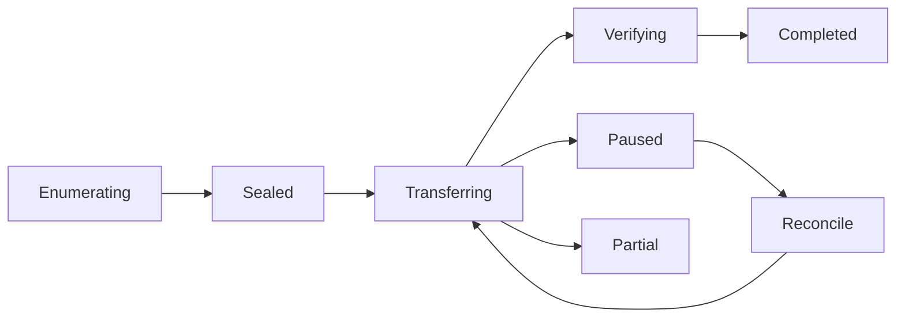

# 批次、文件夹与大文件原操作恢复

## 当前依据与交付边界

现有上传使用 8 MiB 分片，浏览器创建请求临时生成幂等键；创建响应丢失和批次恢复需要持久身份，整文件再次拼装也不适合 100 GiB 目标。

当前依据：[internal/service/http.go](../../../server/internal/service/http.go)、[internal/service/tools.go](../../../server/internal/service/tools.go)、[internal/service/model.go](../../../server/internal/service/model.go)、[docs/contract-map.md](../../../docs/server/contract-map.md)。检查源码只证明当前实现形状，本文没有执行新增运行时测试或真实后端验证。

本包owner：`cli/drivebridge/server`；准入：`fit`；能力账本：`required / design`。消费方只能通过公开合同；新库、新worker和新命令仍归现有owner，不新增产品仓库。

## 前置、任务依赖与唯一写入

- [drivebridge-capability-readiness-v2](../drivebridge-capability-readiness-v2/design.md)：依赖合同先稳定；本包消费其公开接口，不写其私有状态。
- [drivebridge-team-runtime-projections-v1](../drivebridge-team-runtime-projections-v1/design.md)：依赖合同先稳定；本包消费其公开接口，不写其私有状态。

本包内部主链为1.1→1.2→2.1→2.2→3.1→3.2→4.1→4.2→5.1；5.2规模验收和6.1文档在5.1后推进，6.2等待二者完成。前置包的1.2合同稳定即可启动设计；运行集成需对应应用服务与入口已通过定向验证，不能以仅有spec满足运行依赖。没有子Agent自动授权，后续实现按拥有路径串行写；独立规格可分别审阅，稳定diff后才验收。

## 用户流程与状态

场景：文件夹上传→创建响应丢失→重选文件→原任务校验完成。



只读检查、执行意图和最终结果分开；partial保留逐项结果，结果未知先回读原ID。恢复不更换来源、身份、目标或幂等键；取消不等于删除已完成副作用。

## 数据与版本

UploadBatch 与 UploadBatchItem 只组织原 Operation；批次键绑定 actor、tenant、space、目标策略，item_key 固定相对路径+源指纹。新增 UploadSession 保存协议版本、耐久分片和后端会话；不重解释旧 Operation 状态。

新增关系字段采用可空或安全默认值，新增索引可回填；不删旧列、不改旧ID或URI。引用资源通过application service建立，配置/计划/回执/清单不由Agent手写。

## 公开接口与具体行为

| HTTP / 入口（规划，非已上线） | MCP / 客户端面 | SDK / 应用服务操作（规划） | 输入与结果 |
| --- | --- | --- | --- |
| POST /api/v1/upload-batches | upload_batch_create | CreateUploadBatch | space_id、conflict_policy、idempotency_key；返回 batch_id |
| POST /api/v1/upload-batches/{id}/items | upload_batch_add_items | AddUploadBatchItems | 每页≤500，relative_path、size_bytes、sha256、item_key、可选 expected_version |
| POST /api/v1/upload-batches/{id}/seal | upload_batch_seal | SealUploadBatch | 结束枚举并验证批次指纹；新任务返回 operation_id |
| GET /api/v1/upload-batches/{id}/items | upload_batch_get | GetUploadBatch | cursor、limit≤200；逐项状态与原 operation_id |
| POST /api/v1/operations/lookup | operation_lookup | LookupOperation | action、idempotency_key、original_request；服务按原创建函数计算指纹，在当前 actor 范围内查原请求 |
| POST /api/v1/upload-batches/{id}/{pause,resume,cancel} | upload_batch_pause、upload_batch_resume、upload_batch_cancel | ControlUploadBatch | 决策回读原批次，不生成新来源 |
| 既有 PUT /api/v1/operations/{id}/parts/{index} | 字节不走 MCP | PutPart | 旧操作保留 8 MiB；会话返回本操作的 part_size |

表中GET/POST和花括号动作表示分别注册的路由，顿号分隔的是独立工具/SDK名称，不能作为字面路径或工具别名调用。表中的SDK名称是待实施应用操作名，不表示已有导出符号。落地时CLI/MCP/HTTP必须调用同一应用服务，SDK无付费重试、权限扩张或自动切换后端逻辑；开发者不能把接口表当作当前可执行命令。

- 客户端在发请求前持久保存非秘密 idempotency_key、instance/actor/space、相对路径、摘要和批次标识。lookup 未找到只能用同键同指纹重放；unknown 时不得换键重建。
- 文件夹保留相对路径，空目录作为显式条目；拒绝绝对路径、..、越界符号链接及目标后端大小写/名称规范碰撞。默认冲突 fail；keep_both 显式选择；new_version 必须 file_id+expected_version。
- 预检不预占整个万文件批次容量；item 调度时原子预留，最多4文件并行，默认2个在途分片/文件且受服务器全局预算限制。无余量项等待或 quota_exceeded，不影响已完成项。
- 浏览器 hash 在 Worker 中分块计算。重开需重新授权文件句柄或重选文件，大小和 SHA-256 不同即 content_mismatch；不能只按文件名匹配。
- 团队新会话用受管对象暂存，分片耐久确认后才确认 received；worker 流式校验、按 provider 重组，避免本地分片+assembled 双份100GiB落盘。必须保存字节范围与摘要映射；不会仅凭TCP发送成功报告耐久。
- S3 后端默认64MiB multipart，100GiB为1600片；OneDrive 默认10MiB顺序范围（320KiB倍数），Google Drive 默认8MiB（256KiB倍数）。旧8MiB客户端片与后端片不是同一个编号空间。
- 新上传会话分片ACK来源、并发能力、暂存范围和恢复要求由协议明确。加密空间沿用加密分帧与明文摘要校验，不为大文件默默改成明文。
- pause 阻止新调度且保留已验证数据；cancel 不删除已提交文件。后端session过期先对账，不能自动创建另一个任务；经原主体显式恢复可在原Operation下重建已证实失效的传输会话，记录会话代次。
- 提交前完整摘要核验与授权复核，后端读回校验完成才发布最终版本。旧客户端 complete 仍走旧同步语义；新批次采用异步 seal/poll，不改变旧返回类型。

## 共同合同约束

本包为 **设计与待实施合同**。本文规划路径、工具、字段、类型和状态尚未上线；不能把 spec strict 成功当成实现、真实后端或部署验收。既有接口须先从实际 tools/list、inputSchema、CLI help 与公开API确认。新能力默认关闭，部署配置未启用时报告 unsupported/blocked。

- HTTP 沿用各 owner 现有错误信封及认证；身份从会话/令牌推导，body 中的 tenant/actor/project 只能收窄选择范围。CLI 保留 human/--json/--agent 与已实现输出选项，不为旧入口改变必填字段或输出类型。
- 新写请求采用 Idempotency-Key 或该工具对应 idempotency_key，作用域为 instance+tenant+actor+action，指纹覆盖所有业务输入；同键同指纹复用，同键异指纹拒绝。已有入口保持原幂等作用域，禁止重解释旧键。编辑/执行携 expected_revision/expected_version；过期拒绝，不自动重算或批准。
- DriveBridge新分页默认50、最大200；Manju既有查询保留默认20/最大100及8秒预算，旧分页不变；游标不透明，绑定规范查询、身份范围、排序与数据代次。所有页重新授权；跨查询、跨身份游标拒绝。精确列表使用keyset稳定排序，以ID破同值；语义Top-K不是全集，异步导出使用独立原Operation。
- 新元数据与类型由应用服务/CLI生成，GORM为Go业务持久访问层；禁止在handler/SDK适配器拼接SQL。迁移、专用队列领取和分析器例外集中adapter、绑定参数、限定标识符，并在实现review列明理由。
- 保持现有 File/Version/Operation、URI、旧状态枚举与字段含义。本文流程节点描述新增流程或展示阶段，不是把旧 Operation.status 替换成一套新枚举。未知外部结果以新增 certainty/恢复信息表达，不伪报失败或成功。
- 整理、传输、内容处理与领域采纳是不同事实；不会因保存文件批准生成、付费、发布或采纳。回执不含凭据、临时URL、原始模型请求或完整内部推理。
- 基本错误：invalid_query/invalid_request=400，forbidden=403，not_found=404，idempotency_conflict/version_conflict/plan_stale=409，cursor_expired=410，unsupported=400（沿用既有Server映射），budget_exceeded=429，dependency_unavailable=503。保留已有错误码及状态码，专有新码见本包表；不得把旧同名码改义。


## 丢失响应与耐久ACK的具体约定

lookup携action、原idempotency_key和original_request（与原创建相同的业务参数，不含认证信息）；Server复用创建函数规范化并计算指纹，避免浏览器与Go自行实现不同的JSON哈希规则。查无记录只允许同键同original_request重放；同键存在异指纹返回idempotency_conflict。该恢复路径不以收到过创建响应为前提。

团队暂存将每个客户端8MiB分片写成独立受管暂存对象，object key由operation/index/verified digest派生。完成独立对象耐久写入、摘要和Part元数据后才ACK；不等待累计到64MiB才确认客户端，否则旧顺序客户端可能死锁。目标S3 multipart再流式聚合8个客户端片为64MiB；staging对象数量与最终multipart片数不是同一限制。重试同index同摘要复用，异摘要part_conflict；孤立暂存对象通过原operation对账后清理。

暂存对普通用户/Agent不可列举，受原操作期限与容量预算保护。ACK之前失败由同片重发；ACK之后本地进程重启不丢字节。加密空间保存既有加密帧与明文偏移映射，目标组装时不降级加密；最终仍对解密后的明文SHA-256完成读回验证。

## 输入、结果与错误样例（规划）

以下标识符为说明性占位，不是可执行请求；实现测试由fixture/CLI生成合法ID。HTTP成功结果沿用owner现有信封，下面展示payload；CLI/MCP映射保持各自旧信封。示例不授予权限。

输入：

```json
{
  "action": "upload_batch_create",
  "idempotency_key": "upload-batch-example",
  "original_request": {"space_id": "SPACE_ID", "conflict_policy": "fail"}
}
```

结果：

```json
{
  "found": true,
  "batch_id": "BATCH_ID",
  "operation_id": "OP_ID",
  "result_certainty": "confirmed",
  "recovery_action": "read_original_operation"
}
```

UploadBatch响应含batch_id、batch_revision、phase、items_total、items_completed、items_failed、items_waiting和next_cursor；items_total在seal前可为null。Item含item_key、source_fingerprint、relative_path、operation_id及result_certainty。UploadSession返回part_size、received_parts/已验证范围、durability、source_reselection_required。旧Operation响应形状不替换。

| 新码/沿用码 | HTTP状态（旧码保留现有映射） | 恢复行为 |
| --- | --- | --- |
| `content_mismatch` | 400 | 重新选择原文件；新内容必须显式新意图。 |
| `batch_not_sealed` | 409 | 继续原批次枚举并seal。 |
| `source_reselection_required` | 409 | 只要求用户重新选择原来源，不宣称服务端能读本机路径。 |
| `transfer_session_expired` | 409 | 先核对原目标；人工恢复同Operation的传输会话代次。 |

本包规模验收固定为：10000项包含0字节/空目录/Unicode/冲突；100GiB真实流断点恢复与读回摘要，记录4文件并发时单传输buffer≤256MiB及暂存占用；不能用size字段或稀疏文件代替传输。

## 测试规格与故障注入

| 场景 | Requirement | 正常与反例 | 必须断言 |
| --- | --- | --- | --- |
| 1 | 批次与原幂等身份 | 创建响应丢失；同键不同源摘要 | 取得唯一操作；不会新增版本或重复预留。 / idempotency_conflict，保留原任务。 |
| 2 | 耐久分片和源校验 | 100GiB传输中断；选择同名不同内容 | 恢复缺失范围且最终读回摘要一致。 / content_mismatch，既有分片不被替换。 |
| 3 | 批次部分失败与取消 | 万项中十项失败；提交与取消竞态 | 已成功项不重写，只处理失败/未执行且仍授权的项。 / 保留文件并报告已完成副作用，不声称撤回。 |
| 4 | 协议兼容与后端重组 | 旧单文件客户端；100GiB使用S3 | 原返回字段与状态仍兼容。 / 分片数在后端能力限制内，单文件不整块入内存。 |

还需覆盖相同请求重放、并发编辑、权限撤销、跨租户、来源变更、进程重启、响应丢失，以及旧客户端缺新字段时的行为。性能验收只覆盖本包相关部分，统一目标见 [本owner验收与路线文档](../../../docs/server/file-platform/verification.md)。

实施任务先加入明确测试入口后运行以下命令；无匹配测试或输出no tests to run属于失败，不能以空运行关闭任务。当前文档轮次不执行产品测试。

```bash
python3 scripts/check.py -- go test ./internal/service -run TestFPUploadRecovery -count=1
python3 scripts/check.py -- go test -race ./internal/service -run TestFPUploadRecovery -count=1
```

集成证据由现有runner写入本owner `temp/integration-test-runs/<run-id>/`，包含summary.json、command.txt、stdout.log、stderr.log、env.json与artifacts/；失败同样保留并脱敏。真实存储、身份、模型费用与部署分别验证，不由fixture代替。

代码、定向测试和文档稳定后，才执行本包所需最终门：

```bash
python3 scripts/check.py
go vet ./...
CGO_ENABLED=0 go build ./cmd/drivebridge-server
openspec validate drivebridge-upload-batch-recovery-v2 --strict --no-interactive
git diff --check
```

## 迁移、回滚与完成定义

- 当前只新增设计文档，运行时迁移未执行；实现按expand-then-contract，兼容既有客户端、元数据和凭据来源。
- 默认关闭新能力；关闭开关停止新意图，保留原Operation、文件、版本、计划、回执与审计。新版本已产生业务写入时，不允许回滚为丢弃这些写入的旧数据库快照。
- 本包负责自身配置与状态，不替消费者执行部署、发消息、真实云写入、付费调用或发布；这些门由相应owner独立验收。
- 设计完成=proposal/design/spec/tasks可追溯且strict通过。实现完成=任务指定运行证据通过。真实后端验证与发布部署是后续独立事实。

## 范围记录

2026-09-25：按用户确认的百万文件/万文件批次/100GiB目标和分层数据方案建立本包；目标未验收，required能力仅分期，不删除。
