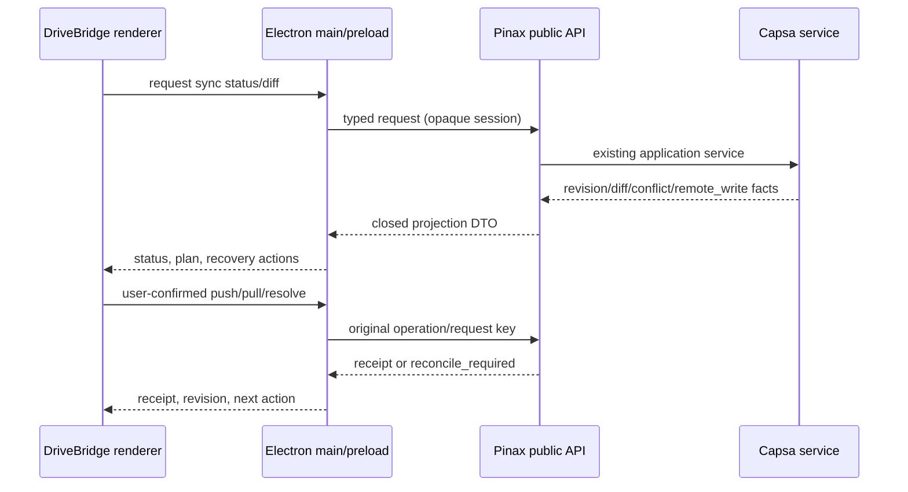

## Owner 与边界

Pinax 是 Markdown vault、对象身份、正文、附件 placement、提案／应用／快照、revision 和 Capsa sync 的唯一 owner。DriveBridge 是消费者和本机体验 owner；它只能调用公开 REST/RPC/typed client contract，不读取 `.pinax/**`、SQLite、绝对路径或 provider payload。Electron main/preload 保存 loopback bearer、文件选择票据和 Pinax session；renderer 只接收闭合 DTO。

本地实现先覆盖合同和 fixture。真实远端 endpoint、跨设备 sync、Mac/Windows/Linux 签名与安装、主力 vault dogfood 仍需独立 owner 证据。

## Sync control flow

`sync.status` 和 `sync.diff` 是只读计划面；`sync.push`、`sync.pull`、`sync.conflicts.resolve` 继续要求 owner write gate 与显式确认。`remote_write=true` 只有在远端 durable commit、返回 revision 且本地 read-back 成功后才能由 Pinax 产生。DriveBridge 的文件上传、hydrate 或本地 projection 不得更新 Capsa revision。

## Notebook workbench

工作台状态机是纯状态转换：

`bound → reading → draft → preview → applying → succeeded | conflict | unknown | revoked`

草稿只在 renderer 内存中存在；恢复槽只保存 opaque operation key。任何 rich/composed 预览都带 `source_anchor`、`origin`、固定 `revision` 和嵌入状态。嵌入目标必须单独打开和授权；cycle、unavailable、depth limit、unsupported 和不安全映射都成为明确状态。编辑只提交原 Markdown source 的 proposal，不接受 composed projection 或 renderer 路径写入。

附件使用现有 inputrequests 临时输入合同：Pinax 校验 MIME/大小、placement、固定 note identity、revision guard、快照、正文引用更新和 receipt。DriveBridge 不把本机路径或任意文件句柄传给 renderer API。

## 当前交付与限制

### 2026-10-26 继续推进

消费者 owner 的 `D08.1` 补齐每次 Pinax 调用前后的 guard lease、原 binding/source/instance/epoch 与物理目录复检，release 等待有界 owner 会话排空；隐藏不释放，release 后重新绑定不复活旧 epoch。`D03.6` 将完整受管树的 guard 接到 provider/local 共享写入裁决，覆盖普通正文而非仅元数据；明确 Pinax local adoption 是绑定前置条件。持久化 worker、另一 space 的本地 alias 和祖先操作采用同一判据。实现、测试和进度真源在 `cli/drivebridge/openspec/changes/drivebridge-desktop-knowledge-reader-v1/managed-vault-guard-protocol.md` 与该 change 的任务回执。

这些本地切片不关闭 D03/D08 父任务。早期进度中的 Server 构造、R1 外围入口、host 接线与 proposal-only 会话已分别有本地证据；当前主要缺口为旧分发 artifact 的 C1/C11、跨 state writer 枚举、全入口并发发布复检矩阵及旧 mount 迁移准入。R02/R03、macOS/COS/Keychain、长期自然使用与用户决策门保持原定义，不生成用户 outcome，不因自然日期已过而勾选。

### 全部未完成规格的推进目标（2026-10-24）

持续 goal 覆盖本 change、`pinax-passphrase-s3-bootstrap`、`pinax-daily-knowledge-loop-v1`、`pinax-real-judgment-acceptance-v1`、`pinax-trusted-continuity-dogfood-v1`、`pinax-agent-memory-runtime` 及必要的 DriveBridge 消费者依赖。Pinax 能力属于 `fit`；Electron、managed-vault 和消费者会话属于 `split-owner`，实现与验收记录留在 `cli/drivebridge`。各 change 的 `tasks.md` 保持进度真源；本节只定义推进顺序，不复制另一套任务状态。

先完成 R01 工程质量门：对已有失败按当前规范归因，保留兼容、安全、原操作恢复和完整用户流程覆盖，先运行定向检查，再运行完整非 race 门禁。新增窄屏输出错误传播回归，修正旧 CLI 帮助、资源列和补全协议断言。Pinax 与 DriveBridge 都通过各自要求后才关闭 R01。

随后完成 D03/D08 的保护方案和可丢弃环境证明，再连接 D14.3 的真实 Electron 编辑纵切。旧 writer、独立 state、已有句柄、别名与 ancestor rename/delete 必须进入保护反例矩阵；registry 字段和 UI 禁用按钮不能作为 guard 证明。系统权限变更、服务安装和真实用户数据迁移须先形成可审查方案，再取得具体动作授权。不得用私有 vault 副本悄悄替换用户工作流。

DriveBridge D03.4 已完成未接产品的 Linux state 栅栏组件：原 process lock、目录身份与 source revision 复验、持久原数据库快照和原子格式标记、五个真实进程中断点及原 migration identity 恢复。`fenced` 只表示维护布局，不授予 guard/binding/session；跨 state/旧 release/Server 构造与应用保护域仍需后续验收。实现与证据真源为 `cli/drivebridge/openspec/changes/drivebridge-desktop-knowledge-reader-v1/state-fence-protocol.md` 和该 owner 的 D03.4/D03.5 任务，Pinax D03/D08 不提前关闭。

关联 handoff 也纳入持续盘点：`pinax-continuity-operator-handoff-v1` 当前剩余 4.1 跨 runtime 真使用验收、4.2 closeout。其任务声明的 owner 为根仓 Skill/profile 治理，依赖 continuity 的真实报告和 Go/Iterate/Stop 回执；不将这两项当作 Pinax 核心代码缺口，也不以工程检查代填完成。执行期间如出现其他 active change，先核对 owner 与依赖再纳入，保留并行修改。

本地链路成立后，R02 与 S3 7.5–7.9 收集真实云 endpoint、跨设备收敛、macOS release candidate/Keychain、恢复矩阵和平台支持证据。真实外部写入与发布按具体目标授权；本地 mock、交叉编译或 Linux 运行不代替这些门槛。

R03、daily 7.1、judgment 1.3、continuity 8.3–8.4 与 memory 8.5–8.6 复用各自已有工具和原始证据：两周主力使用、真实案例用户复核、至少 30 次 substantial loops、两种 runtime/三类任务及四周 adapter/Codex 使用观察。可以核对已有记录，不能生成用户 outcome、补写不存在的使用记录或用自然时间流逝证明验收。缺项保持 open。

最终完成各 owner 任务回填、规格同步和 closeout；只有全部必需验收满足，持续 goal 才完成。自然观察、平台与用户决策门尚未满足时，优先继续独立的可执行工程项；无可执行项后明确报告所缺证据。

工程门补充覆盖 operation lock 初始化窗口：`O_EXCL` 创建路径后 JSON 尚未写完时，竞争者必须得到 `lock_held`，保留原文件，不将空或损坏元数据视为 stale。确定性空/截断/类型错误用例和已有协作并发保存、过期锁恢复共同验证此合同。该修复只规范失败闭锁行为，不代表重构了现有 TTL 与 stale 回收策略；永久损坏的锁仍需核实原操作后恢复。

本变更已实现 Pinax sync control 的公开注册、REST/RPC handler、schema、typed client 和公开 push/pull/conflicts.resolve 的通用 operation ledger 绑定；原 identity 可通过 sync receipt 完成跨进程 reconcile。附件采用沿用显式启用的 MCP input surface，公开 typed DTO/schema 位于 `pkg/inputcontract`，新增／替换经过固定 identity、完整 revision、snapshot、原子引用更新和 receipt；不新增附件 REST/RPC 端点。详细边界和矩阵见 `docs/interfaces/notebook-backend-recovery-and-attachments.md`。DriveBridge 的 writer/sync contract generator 已于 2026-10-23 从当前 owner export 重新生成并通过漂移门；纯状态机补齐页面内草稿、原 key 终态恢复和撤权清空，只读 Sync 面板通过 fixture 浏览器组件验收。2026-10-24 独立 opaque recovery slot 复用 notebook Web Locks/storage，在 actor/source/binding 隔离槽中只保存原 key，跨 reload 回读与 CAS 清理通过真实浏览器组件测试；本 spec 的纯状态机/草稿/恢复槽 D14.2 完成。完整 writer/preload 与真实宿主集成仍属于 DriveBridge D14.2 父项和 D14.3，保持未完成。D03/D08 保护域和 D14.3 真实 Electron 纵切只有在宿主 guard、可丢弃 vault 和进程证据齐备后才可勾选。

### 未完成任务门分类（2026-10-24 冻结）

R01 已在 2026-10-24 重新取得绿色证据：Pinax `task check` exit 0（`temp/integration-test-runs/gate-baseline-20261024T142328Z-1097565/`，70 Go 包、0 失败、lint 0 issues、OpenSpec 111/111、renderer 2 文件 4 测试）；DriveBridge `make contracts-check` 三门与 `make check` exit 0（`cli/drivebridge/temp/integration-test-runs/gate-baseline-20261024/`，web 196 文件 1354 测试）。本轮无新增失败需要归因，也未运行 race 或执行外部动作。

剩余 19 个 Pinax 任务按门类型分类。`G1` 指本 checkout 内可实现的代码或合同缺口；`G2` 指必须由真实外部环境/账号/设备产生的证据；`G3` 指需要用户或产品决策的回执。本表只登记门类型与验证入口，任务状态真源仍是各 change 的 `tasks.md`。

| 任务 | 门 | 验证入口 / 所需外部动作 |
| --- | --- | --- |
| `pinax-drivebridge-workbench-v1` D03/D08 | G1 | 保护方案 + guard 本地实现与跨入口反例矩阵；owner 实现位于 `cli/drivebridge`，需可丢弃 state，不需要真实账号 |
| `pinax-drivebridge-workbench-v1` D14.3 | G1 + G2(部分) | 真实 Electron 进程 + 可丢弃 Pinax vault 的编辑/恢复纵切；Linux 本机可执行，三平台仍留在 DriveBridge D10 |
| `pinax-drivebridge-workbench-v1` R02 | G2 | 真实 Cloud Sync endpoint、跨设备收敛、`remote_write`/read-back；需真实远端与第二设备 |
| `pinax-drivebridge-workbench-v1` R03 | G2 + G3 | 三类真实 Obsidian vault、两周主力 vault dogfood、Proof Loop restore；需用户 vault 与使用回执 |
| `pinax-passphrase-s3-bootstrap` 7.5–7.9 | G2 + G3 | 真实 macOS 发布候选 + Tencent COS + Keychain 的 bootstrap/pull、canary round-trip、恢复矩阵、平台表述与 closeout；现有 runner 为非 Darwin fail-closed |
| `pinax-daily-knowledge-loop-v1` 7.1 | G2 | 两周真实主力 vault 自然使用观察 |
| `pinax-real-judgment-acceptance-v1` 1.3 | G2 + G3 | 需局部 adapter 环境（正式授权模型通道与预算）执行 `run --limit 3`，并由用户复核；不得代填 outcome |
| `pinax-trusted-continuity-dogfood-v1` 8.3 | G2 | ≥30 次真实 substantial continuity loops，Codex/Claude 与三类任务均有样本，每次由用户提交或明确缺失 outcome |
| `pinax-trusted-continuity-dogfood-v1` 8.4 | G3 | 依据预登记门槛（≥30 loops、trusted ≥80%、sources ≥95%、双 runtime、三 task class、weekly review ≤300s、silent writes=0）记录唯一 Go/Iterate/Stop |
| `pinax-agent-memory-runtime` 8.5 | G2 | 连续四周真实 recall/source/proposal/handoff 观察 |
| `pinax-agent-memory-runtime` 8.6 | G3 | 依据 8.5 回执决定 stable-from 或继续 experimental |

推进顺序按 G1 → G1 → G2/G3 收口：先完成 D03/D08 设计与实现，再接 D14.3 真实 Electron 纵切；G2/G3 项只做证据核对、runner 就绪性与 operator 运行说明，不生成用户 outcome，不用 fixture 或自然时间流逝替代。G2/G3 未满足时持续 goal 保持未完成并明确报告所缺证据。

已就绪的 operator 入口（不构成通过）：`task integration:sync-macos-candidate` 在非 Darwin 返回 `macos_platform_required` 并写脱敏失败证据；`scripts/judgment-acceptance.py`（owner=pinax，opt-in）具备 inventory/run/review 三个子命令与离线自测；`pinax continue report --since 6w --json` 与 `pinax agent status --json` 提供真实分母投影。

### 推进状态（2026-10-24 本轮）

| 步骤 | 状态 | 证据 / 缺口 |
| --- | --- | --- |
| 1 R01 工程门 | 通过 | `cli/pinax` `task check` exit 0（`temp/integration-test-runs/gate-baseline-20261024T142328Z-1097565/`：70 包、0 失败、lint 0、OpenSpec 111/111、renderer 4 测试）；`cli/drivebridge` `make contracts-check` 三门 + `make check` exit 0（`temp/integration-test-runs/gate-baseline-20261024/`：web 196 文件 1354 测试、双 vet、tsc、三处 build）。无失败需归因；未运行 race |
| 2 managed-vault 保护设计 | 完成 | `cli/drivebridge/.../managed-vault-guard-protocol.md`：三层保护、CAS 安装事务、五个复检点、会话隔离、C1–C12 反例矩阵；`design.md` 与 D03 任务已引用；strict 通过 |
| 3 managed-vault 本地实现 | 部分 | guard 三表、`PreviewGuard` 域枚举、`InstallGuard` CAS 事务、`SetGuardVisibility`、`ReleaseGuard`（epoch 递增）、Linux device/inode 身份、`fenced` 布局启动解析已实现；25 例定向 `20261024T145142Z-c8917067`、`internal/bridge` 全包 `20261024T145150Z-46a0c51f`、vet `20261024T145415Z-b1898a3d`、build `20261024T145416Z-aeb97b79`，均在 `cli/drivebridge/temp/integration-test-runs` |
| 4 D14.3 真实 Electron 纵切 | 完成（proposal-only 范围） | 环境前置已实测（Electron 44.5.1 离线安装、xvfb 真实进程、沙箱渲染器，`20261024T145510Z-ab88a3be`）；Pinax 公开 writer 面存在。消费者侧已补：D08 跨入口同义拒绝（`20261024T151446Z-6af6f85c`、server `20261024T151450Z-0958a995`）、host `Admission` 接缝与真实 CAS binding（`20261024T152831Z-a30fd56f`）、release/visibility 路由（`20261024T153050Z-dfc203e6`），三次 `make check` 均 exit 0。前置已全部落地：host 在私有 bootstrap 后按默认配置路径附加已存在的 owner state（不自动初始化）、preload 暴露 7 个声明方法、main 逐方法校验、host 按 scope 打开 owner 会话。真实 Electron 纵切覆盖 bind→notes→editor-source→draft proposal→revision conflict→重启回读→跨 vault 同 ID→释放丢响应 replay→撤权，证据 `20261024T163822Z-2722d77c`、`20261024T163830Z-98e659b7`、`electron-slice-20261024`。按冻结设计 proposal-only；apply 与 D09 reader 广度另计 |
| 5 真实外部证据 | 未取得 | 全部为 G2/G3 门（见上表）：需真实 macOS 发布候选/COS/Keychain、真实云 endpoint 与第二设备、用户案例复核与付费授权、两周日常使用、四周记忆观察、≥30 次真实 continuity loops 与 Go/Iterate/Stop。2026-10-24 门就绪性复核（不含任何外部动作）：macOS candidate runner 在 Linux 正确 fail-closed 返回 `macos_platform_required` 并写脱敏失败证据（`temp/integration-test-runs/20261024T164321Z-2728955`）；`pinax continue report --since 6w --json` 在一次性 vault 上成功执行并如实报告 `completed_loops=0`、`gate_sample_ge_30 fail (0; want >=30)`、`gate_source_resolvability not_measured`、`cross_project_routing=unvalidated`；`pinax agent status --json` 成功执行且空数据不伪造分母。三项都证明 operator 入口可用且失败闭锁，但不构成任何任务通过 |
| 6 规格收口 | 未开始 | 依赖步骤 5；各 change 保持 active，不归档 |

步骤 3 仍开放项（不计完成）：C1 已发布旧 binary 的真实进程证据（D03.5）、C2 Server `Open` 构造拒绝、生产 startup/admission 接线、R1 四个外围入口（`local_preview.go`/`webdav.go`/`RemoteSurfaces.UploadLocalFile`/`local_creative.go`）、writer 会话与 D14.2/D14.3。

G2/G3 门不由本轮产生；按本 change 既有规则，fixture、组件测试、自然时间流逝与工程完成度都不能替代它们。因此本持续 goal 保持未完成。
